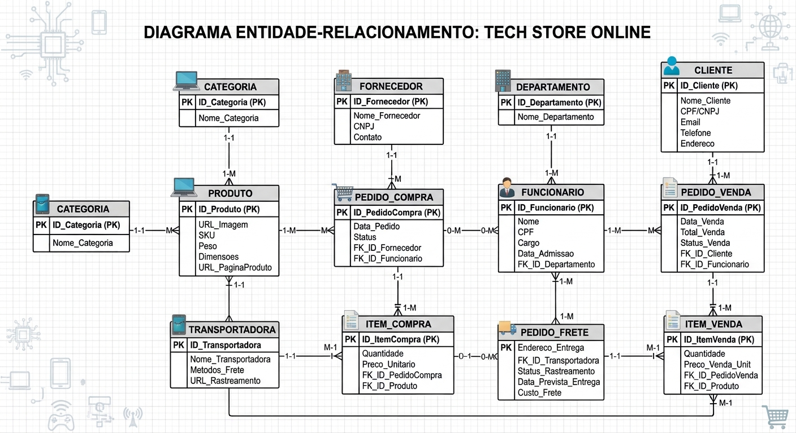

TCC-NomeDoProjeto/
├── README.md
├── docs/
│   ├── requisitos.md
        Funcionais: Tela de login, Tela inicial, comprar produto, carrinho de compras, cadastrar endereço
        Não funcionais: Ver onde está o produto
│   ├── arquitetura.png
        Tela de Login
        Tela Inicial
        Tela Carrinho de Compras
        Tela Acompanhar pedido
│   ├── banco-der.png
        
│   └── prototipos/
│       ├── tela-inicial.png
            
│       ├── tela-cadastro.png
            
│       └── tela-consulta.png
            
├── frontend/
├── backend/
└── app/